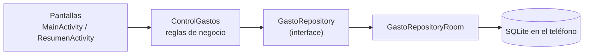

#  Control de Gastos

Aplicación Android para registrar **gastos** e **ingresos**, ver el balance actual y consultar un resumen mensual. Los datos se guardan en el propio teléfono.

Proyecto académico del curso **Programación 2 (UMG)**. La lógica del negocio vive en una **librería Kotlin independiente** (`gastos-core`, hecha con IntelliJ IDEA y Maven) y esta app de Android la consume como dependencia.

---

##  Características

- **Dos grupos de categorías:** Gastos (22 categorías) e Ingresos (5 categorías).
- **Registro rápido:** al tocar una categoría se abre una ventana con:
  - fecha puesta automáticamente,
  - monto con teclado numérico propio (0-9, punto decimal y borrar),
  - campo de nota opcional.
- **Lista de movimientos** debajo, del más reciente al más antiguo, con categoría, nota, fecha y monto (rojo para gastos, verde para ingresos).
- **Balance actual** en la parte superior (todo lo ingresado menos todo lo gastado).
- **Resumen del mes** en otra pantalla: ingreso del mes, gasto del mes y saldo restante, con flechas para cambiar de mes.
- **Eliminar** un registro con confirmación.
- **Persistencia local** con Room (SQLite): los datos siguen ahí al cerrar la app.


##  Arquitectura

El proyecto se divide en **dos partes**:

| Parte | Herramienta | Qué contiene |
|---|---|---|
| `gastos-core` (librería) | IntelliJ IDEA + Maven | Modelo, reglas de negocio y contrato de acceso a datos. Kotlin puro, sin nada de Android. |
| `ControlGastos` (esta app) | Android Studio + Gradle | Pantallas, base de datos Room y todo lo visual. |



**Idea clave:** `ControlGastos` solo conoce la *interface* `GastoRepository`, no cómo se guardan los datos. Por eso se pudo empezar con una lista en memoria y cambiar a Room modificando una sola línea en `ServicioApp.kt`, sin tocar las pantallas ni las reglas.

---

## Tecnologías

| Componente | Versión |
|---|---|
| Kotlin | 2.1.20 |
| Android Gradle Plugin | 8.7.3 |
| Gradle | 8.9 |
| KSP | 2.1.20-1.0.32 |
| Room | 2.6.1 |
| Material Components | 1.12.0 |
| AppCompat | 1.7.0 |
| RecyclerView | 1.3.2 |
| Lifecycle (runtime-ktx) | 2.8.7 |
| `compileSdk` / `targetSdk` / `minSdk` | 35 / 34 / 24 (Android 7.0 o superior) |
| Librería `gastos-core` | `umg.edu.gt.progra2:gastos-core:1.1.0` |

Interfaz construida con **Views XML + View Binding** (sin Compose).

---


## Estructura del proyecto

```
ControlGastos/
├── app/
│   ├── build.gradle.kts
│   └── src/main/
│       ├── AndroidManifest.xml
│       ├── java/edu/umg/controlgastos/
│       │   ├── GastosApp.kt            # Application: inicia la base de datos al abrir la app
│       │   ├── ServicioApp.kt          # Único ControlGastos compartido por las pantallas
│       │   ├── MainActivity.kt         # Pantalla de registro
│       │   ├── ResumenActivity.kt      # Pantalla de resumen del mes
│       │   ├── CategoriaAdapter.kt     # Tarjetas de categorías
│       │   ├── MovimientoAdapter.kt    # Tarjetas de movimientos
│       │   ├── IconosCategoria.kt      # Iconos opcionales (MOSTRAR_ICONOS); por defecto solo texto
│       │   └── datos/
│       │       └── GastoRepositoryRoom.kt   # Entity, DAO, base de datos y repositorio Room
│       └── res/                        # Layouts, colores, tema, íconos
├── build.gradle.kts
├── settings.gradle.kts                 # Incluye mavenLocal()
├── gradle.properties
└── README.md
```

### La librería `gastos-core`

```
gastos-core/
├── pom.xml
└── src/main/kotlin/edu/umg/programacion2/gastos/
    ├── modelo/
    │   ├── Tipo.kt                     # GASTO / INGRESO
    │   ├── Categoria.kt                # enum con las 27 categorías
    │   ├── Gasto.kt                    # data class de un movimiento
    │   └── ResumenMes.kt               # ingresos, gastos y saldo de un mes
    ├── datos/
    │   ├── GastoRepository.kt          # interface (el contrato)
    │   └── GastoRepositoryEnMemoria.kt # implementación en memoria (pruebas)
    ├── servicio/
    │   ├── ControlGastos.kt            # validar, registrar, listar, resumen del mes
    │   └── TecladoNumerico.kt          # lógica del teclado 0-9
    └── consola/Main.kt                 # menú de consola para probar la librería
```

---

##  Cómo funciona

**Reglas del negocio** (en `ControlGastos`, no en las pantallas):

- El monto debe ser **mayor que 0**.
- La fecha debe tener el formato **`yyyy-MM-dd`** (la app la pone sola, con la fecha de hoy).
- La nota es **opcional**.
- El **tipo** (gasto o ingreso) no se guarda: se deduce de la categoría, así nunca pueden quedar contradictorios.

**Decisiones de diseño:**

- La fecha es un `String` `yyyy-MM-dd`: se ordena bien como texto y no necesita `java.time`, que no existe en Android anterior a la API 26 (la app soporta desde la 24).
- El monto es un `Double` por simplicidad. Para dinero real se recomienda `BigDecimal` o guardar centavos.
- `ServicioApp` es un `object` para que las dos pantallas compartan el mismo `ControlGastos` y los datos no se pierdan al girar el teléfono.

---

##  Categorías

**Gastos (22):** Transporte, Comida, Ropa, Diario, Comunicación, Belleza, Alquiler, Hogar, Niños, Viajes, Tecnología, Carro, Médico, Libros, Estudio, Mascotas, Regalos, Oficina, Reparaciones, Donación, Familia amigos y Otro.

**Ingresos (5):** Salario, Inversión, Regalos en efectivo, Bonos y Otro.


##  Persistencia de datos (Room)

Los datos se guardan en una base de datos SQLite dentro del teléfono mediante **Room**:

| Columna | Tipo | Descripción |
|---|---|---|
| `id` | Int (PK, autoincremental) | Identificador del movimiento |
| `nota` | Texto | Nota opcional |
| `monto` | Decimal | Monto positivo |
| `categoria` | Texto | Nombre interno de la categoría |
| `fecha` | Texto | Fecha en formato `yyyy-MM-dd` |

- Los datos permanecen mientras la app **no se desinstale**.
- Si en el futuro cambia la estructura de la tabla, hay que subir el `version` de `@Database` y escribir una migración.

---

---

## Solución de problemas

| Problema | Solución |
|---|---|
| *"The project's Gradle version is incompatible with the Gradle JVM version 25"* | Elegir **Use JVM 21**, o en *Settings → Build, Execution, Deployment → Build Tools → Gradle* poner *Gradle JDK* en 21. |
| *"Could not find umg.edu.gt.progra2:gastos-core:1.1.0"* | No se ejecutó `mvn clean install` en la librería, o falta `mavenLocal()` en `settings.gradle.kts`. Verifica que exista el `.jar` en `~/.m2`. |
| `ksp` aparece en rojo en `app/build.gradle.kts` | Falta el plugin de KSP en los dos `build.gradle.kts` (raíz y `app`). Corrígelo y presiona **Sync Now**. |
| El ícono de la app no cambia | Confirma que el Manifest tenga `android:icon` y `android:roundIcon`, desinstala la app del emulador y vuelve a correrla. |
| La app se cierra al abrir después de renombrar una categoría | Se cambió el *nombre interno* de una categoría con datos guardados. Restáuralo o borra los datos de la app. |
| Los cambios en la librería no se reflejan en la app | Sube la versión en `pom.xml` y en `app/build.gradle.kts`, ejecuta `mvn clean install` y haz Sync. |
| El Gradle Sync tarda muchísimo la primera vez | Es normal (descarga dependencias). Si pasa de 15 minutos, revisa tu conexión a internet. |

---

##  Mejoras futuras

- Desglose de gastos por categoría en el resumen.
- Editar un registro (hoy solo se puede eliminar).
- Filtros por rango de fechas.
- Exportar los movimientos a CSV.
- Guardar el monto en centavos (`Long`) para evitar errores de redondeo.

---

